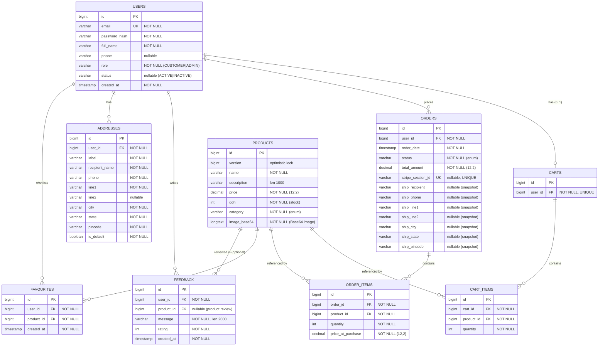

# Database Design — Online Shopping Platform

## 1. Database Architecture Overview

This application uses a **classic layered Spring Boot persistence stack**. There is **no hand-written SQL schema** in the repository — the database tables are generated automatically by **Hibernate (JPA)** from annotated Java `@Entity` classes.

```
Java @Entity classes ──▶ Hibernate / JPA ──▶ SQL DDL ──▶ MySQL tables
(the data model)         (ORM: maps          (auto-        (online_shopping DB,
                          objects⇄rows)       generated)     auto-created)
```

Key facts established from the code and configuration:

- **Engine (production):** MySQL 8, database `online_shopping`, auto-created on startup
  (`spring.datasource.url=jdbc:mysql://localhost:3306/online_shopping?createDatabaseIfNotExist=true`).
- **Schema generation:** `spring.jpa.hibernate.ddl-auto=update` — Hibernate creates/alters tables to
  match the entities at runtime. **There is no `.sql` schema or migration file in the repo**; the
  entities are the single source of truth for the schema.
- **Engine (tests):** in-memory **H2** in MySQL-compatibility mode (`ddl-auto=create-drop`), so tests
  need no external database.
- **Naming:** Hibernate's default strategy maps camelCase Java fields to `snake_case` columns
  (e.g. `passwordHash` → `password_hash`, `stripeSessionId` → `stripe_session_id`).
- **Table count:** **9 physical tables.** `Role`, `Category`, `OrderStatus`, and `UserStatus` are **Java enums**,
  **not** tables — they are persisted inline as `VARCHAR` columns (`@Enumerated(EnumType.STRING)`).

### How the application modules touch the database

| Module / layer | Responsibility | Tables it reads/writes |
|---|---|---|
| `entity/` | JPA-annotated data model (defines the schema) | all |
| `repository/` | Spring Data JPA interfaces (CRUD + derived/`@Query` methods) | all |
| `service/` | Business rules & transactions (checkout, stock, orders, feedback) | all |
| `security/` | JWT auth; resolves current `User` by email | `users` |
| `controller/` | REST endpoints; return DTOs, never entities | via services |

Notable DB interactions:
- **Auth** looks up a user by email (`UserRepository.findByEmail` / `existsByEmail`).
- **Checkout → Payment** creates a `PENDING_PAYMENT` order keyed by `stripe_session_id`; the Stripe
  webhook flips it to `PAID` in one transaction that also **decrements `products.qoh`**, **clears the
  cart** (`cart_items`), and records the sale.
- **Admin reports** run aggregate `@Query` projections over `orders` / `order_items` / `products`
  (sales-by-product, sales-by-category, movement ranking) — these return DTO projections, not new tables.

---

## 2. Entities (Tables), Attributes & Constraints

> Legend — **PK** primary key · **FK** foreign key · **U** unique · **NN** not null

### 2.1 `users`  (entity `User`)
Registered account (Customer or Admin). Central identity record.

| Column | Type | Constraints | Notes |
|---|---|---|---|
| `id` | BIGINT | **PK**, auto-increment (`IDENTITY`) | |
| `email` | VARCHAR | **NN**, **U** | login identifier; **candidate key** |
| `password_hash` | VARCHAR | **NN** | BCrypt hash |
| `full_name` | VARCHAR | **NN** | |
| `role` | VARCHAR | **NN** | enum `Role` {CUSTOMER, ADMIN} stored as string |
| `phone` | VARCHAR | nullable | 10-digit phone; nullable so existing rows are unaffected; backfilled to `NULL` by `CustomerSeeder` |
| `status` | VARCHAR | nullable (defaults ACTIVE) | enum `UserStatus` {ACTIVE, INACTIVE} — soft-delete flag; nullable for the same schema-evolution reason as `phone` |
| `created_at` | TIMESTAMP | **NN**, not updatable | set at creation |

### 2.2 `products`  (entity `Product`)
Catalog item that can be sold.

| Column | Type | Constraints | Notes |
|---|---|---|---|
| `id` | BIGINT | **PK**, auto-increment | |
| `version` | BIGINT | optimistic-lock (`@Version`) | prevents lost stock updates under concurrency |
| `name` | VARCHAR | **NN** | |
| `description` | VARCHAR(1000) | nullable | |
| `price` | DECIMAL(12,2) | **NN** | |
| `qoh` | INT | **NN** | quantity on hand (stock) |
| `category` | VARCHAR | **NN** | enum `Category` {ELECTRONICS, ELECTRICAL, FURNITURE, COSMETICS, TOYS_AND_BOOKS} |
| `image_base64` | LONGTEXT | **NN** | Base64-encoded product image (text; `LONGTEXT` holds up to ~4 GB, well beyond a Base64 image) |

### 2.3 `carts`  (entity `Cart`)
A single shopping cart owned by one user.

| Column | Type | Constraints | Notes |
|---|---|---|---|
| `id` | BIGINT | **PK**, auto-increment | |
| `user_id` | BIGINT | **FK → users.id**, **NN**, **U** | one cart per user (candidate key = `user_id`) |

### 2.4 `cart_items`  (entity `CartItem`) — *association table*
A line in a cart: which product, how many. Resolves the many-to-many between `carts` and `products`.

| Column | Type | Constraints | Notes |
|---|---|---|---|
| `id` | BIGINT | **PK**, auto-increment | |
| `cart_id` | BIGINT | **FK → carts.id**, **NN** | |
| `product_id` | BIGINT | **FK → products.id**, **NN** | |
| `quantity` | INT | **NN** | |

### 2.5 `orders`  (entity `Order`)
A placed order (a checkout attempt / completed purchase).

| Column | Type | Constraints | Notes |
|---|---|---|---|
| `id` | BIGINT | **PK**, auto-increment | |
| `user_id` | BIGINT | **FK → users.id**, **NN** | buyer |
| `order_date` | TIMESTAMP | **NN** | |
| `status` | VARCHAR | **NN** | enum `OrderStatus` {PENDING_PAYMENT, PAID, CANCELLED} |
| `total_amount` | DECIMAL(12,2) | **NN** | |
| `stripe_session_id` | VARCHAR | **U** (nullable) | Stripe Checkout Session id; **candidate key** when present (idempotent webhook lookup) |
| `ship_recipient` | VARCHAR | nullable | Shipping address snapshot — recipient's name. Null for orders placed before this feature was added. |
| `ship_phone` | VARCHAR | nullable | Shipping address snapshot — phone |
| `ship_line1` | VARCHAR | nullable | Shipping address snapshot — address line 1 |
| `ship_line2` | VARCHAR | nullable | Shipping address snapshot — address line 2 (optional) |
| `ship_city` | VARCHAR | nullable | Shipping address snapshot — city |
| `ship_state` | VARCHAR | nullable | Shipping address snapshot — state |
| `ship_pincode` | VARCHAR | nullable | Shipping address snapshot — postal code |

### 2.6 `order_items`  (entity `OrderItem`) — *association table*
A line in an order. Resolves the many-to-many between `orders` and `products`, and **snapshots the price** at purchase time.

| Column | Type | Constraints | Notes |
|---|---|---|---|
| `id` | BIGINT | **PK**, auto-increment | |
| `order_id` | BIGINT | **FK → orders.id**, **NN** | |
| `product_id` | BIGINT | **FK → products.id**, **NN** | |
| `quantity` | INT | **NN** | |
| `price_at_purchase` | DECIMAL(12,2) | **NN** | historical price, independent of later catalog changes |

### 2.7 `feedback`  (entity `Feedback`)
A customer-submitted rating + message.

| Column | Type | Constraints | Notes |
|---|---|---|---|
| `id` | BIGINT | **PK**, auto-increment | |
| `user_id` | BIGINT | **FK → users.id**, **NN** | author |
| `message` | VARCHAR(2000) | **NN** | |
| `rating` | INT | **NN** | numeric score (range not enforced at the DB level) |
| `created_at` | TIMESTAMP | **NN**, not updatable | |
| `product_id` | BIGINT | **FK → products.id**, nullable | if present, this row is a **product review** (tied to that product); if null, it is general site feedback |

### 2.8 `addresses`  (entity `Address`)
One delivery address belonging to one customer. A customer may have many addresses; exactly one is their default.

| Column | Type | Constraints | Notes |
|---|---|---|---|
| `id` | BIGINT | **PK**, auto-increment | |
| `user_id` | BIGINT | **FK → users.id**, **NN** | owner |
| `label` | VARCHAR | **NN** | short nickname, e.g. "Home", "Work" |
| `recipient_name` | VARCHAR | **NN** | name of the person at this address |
| `phone` | VARCHAR | **NN** | contact phone for delivery |
| `line1` | VARCHAR | **NN** | main address line |
| `line2` | VARCHAR | nullable | flat/landmark (optional) |
| `city` | VARCHAR | **NN** | |
| `state` | VARCHAR | **NN** | |
| `pincode` | VARCHAR | **NN** | postal code |
| `is_default` | BOOLEAN | **NN**, default false | true for the customer's currently selected default; "one default" rule enforced in `AddressService` |

### 2.9 `favourites`  (entity `Favourite`) — *association table*
Links one customer to one product they have wishlisted. The unique constraint prevents the same product being added twice by the same customer.

| Column | Type | Constraints | Notes |
|---|---|---|---|
| `id` | BIGINT | **PK**, auto-increment | |
| `user_id` | BIGINT | **FK → users.id**, **NN** | customer who favourited |
| `product_id` | BIGINT | **FK → products.id**, **NN** | the favourited product |
| `created_at` | TIMESTAMP | **NN**, not updatable | when it was added to the wishlist |

Composite unique constraint: `(user_id, product_id)` — prevents duplicate entries.

---

## 3. Relationships, Cardinality & Participation

| Relationship | Type | Cardinality | Participation | Mechanism in code |
|---|---|---|---|---|
| `User` — `Cart` | **One-to-One** | 1 user ↔ 0..1 cart | Cart: **total** (`user_id` NN); User: **partial** | `@OneToOne` + `user_id` UNIQUE NN |
| `User` — `Order` | **One-to-Many** | 1 user ↔ 0..* orders | Order: total; User: partial | `Order.@ManyToOne user` |
| `User` — `Feedback` | **One-to-Many** | 1 user ↔ 0..* feedback | Feedback: total; User: partial | `Feedback.@ManyToOne user` |
| `Cart` — `CartItem` | **One-to-Many** | 1 cart ↔ 0..* items | CartItem: total | `@OneToMany(mappedBy="cart")`, cascade ALL + orphanRemoval |
| `Product` — `CartItem` | **One-to-Many** | 1 product ↔ 0..* cart lines | CartItem: total | `CartItem.@ManyToOne product` |
| `Order` — `OrderItem` | **One-to-Many** | 1 order ↔ 0..* items | OrderItem: total | `@OneToMany(mappedBy="order")`, cascade ALL + orphanRemoval |
| `Product` — `OrderItem` | **One-to-Many** | 1 product ↔ 0..* order lines | OrderItem: total | `OrderItem.@ManyToOne product` |
| `User` — `Address` | **One-to-Many** | 1 user ↔ 0..* addresses | Address: total (`user_id` NN); User: partial | `Address.@ManyToOne user` |
| `User` — `Favourite` | **One-to-Many** | 1 user ↔ 0..* favourites | Favourite: total | `Favourite.@ManyToOne user` |
| `Product` — `Favourite` | **One-to-Many** | 1 product ↔ 0..* favourites | Favourite: total | `Favourite.@ManyToOne product` |
| `Product` — `Feedback` | **One-to-Many** | 1 product ↔ 0..* reviews | Feedback: partial (`product_id` nullable) | `Feedback.@ManyToOne product` (optional) |

**Derived many-to-many relationships** (resolved through the association tables):
- `Cart` **M—N** `Product` *via* `cart_items`.
- `Order` **M—N** `Product` *via* `order_items` (with a price snapshot).
- `User` **M—N** `Product` *via* `favourites` (wishlist; with a timestamp).

**Lifecycle / cascade notes (from the code):**
- Deleting a `Cart` cascades to its `cart_items`; deleting an `Order` cascades to its `order_items`
  (`cascade = ALL`, `orphanRemoval = true`).
- There is **no** cascade from `User` to `orders`/`carts`/`feedback` — those are plain FK references,
  so a user cannot be deleted while such rows exist (DB-level restrict).

---

## 4. Junction / Association Tables

The design has **three association tables**: `cart_items`, `order_items`, and `favourites`.

They differ in payload:
- `cart_items` and `order_items` carry extra attributes (`quantity`; `price_at_purchase`) and are **association entities** in modelling terms.
- `favourites` carries only a `created_at` timestamp and is a **pure junction table** (beyond the timestamp, it only resolves the many-to-many between `users` and `products`).

> **Note:** Neither association table declares a composite uniqueness constraint on
> `(cart_id, product_id)` / `(order_id, product_id)` in the entity mapping. Uniqueness of a product
> within a cart is therefore enforced in application/service logic, not by the schema (see §6).

---

## 5. Entity-Relationship Diagram (Mermaid)

The editable source is also provided as [`er-diagram.mmd`](er-diagram.mmd). Enums are shown as notes
rather than tables because they are stored inline as string columns.



**Crow's-foot cardinality reminder:** `||` = exactly one, `o|` = zero-or-one, `o{` = zero-or-many.
So `USERS ||--o| CARTS` reads "one user has zero or one cart", and `CARTS ||--o{ CART_ITEMS`
reads "one cart contains zero or many cart items".

---

## 6. Summary

- **9 tables**, all surrogate-keyed with auto-increment `BIGINT id`.
- `users` and `products` are the core reference entities.
- `carts`/`cart_items` model the live shopping basket.
- `orders`/`order_items` model committed purchases with a price snapshot; `orders` additionally holds a **shipping address snapshot** (7 `ship_*` columns, all nullable, copied from the customer's chosen address at checkout time — preserved even if the address is later edited or deleted).
- `feedback` stores both **general site feedback** (product_id = null) and **per-product reviews** (product_id present), using a single table differentiated by that optional FK.
- `addresses` stores customer delivery addresses (label, full address, phone, default flag); a customer can have many.
- `favourites` is the wishlist junction table linking customers to products.
- Three association tables (`cart_items`, `order_items`, `favourites`) resolve M:N relationships; `cart_items` and `order_items` are association entities (carrying payload), while `favourites` is a pure junction (timestamp only).
- The entire schema is **ORM-driven** — the JPA entities are the authoritative definition of the database design.
