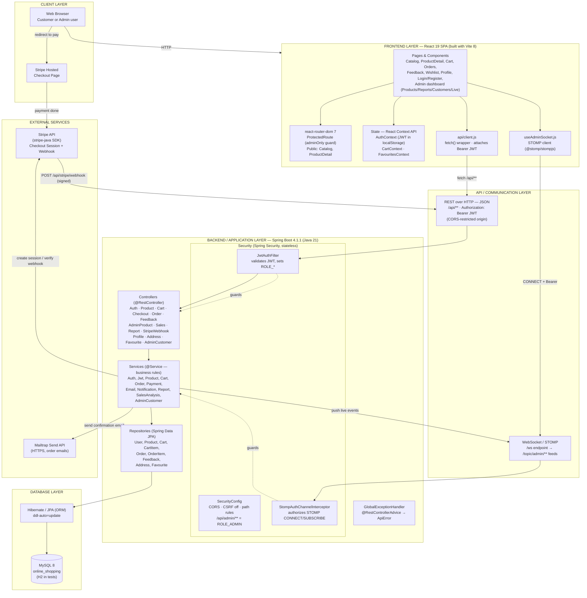

# High-Level Architecture — Online Shopping Platform

## 1. Architecture at a Glance

This is a **classic three-tier web application** with a decoupled single-page frontend, a layered REST backend, a relational database, and two external SaaS integrations (payments and email):

```
Browser (React SPA)  ──REST/JSON over HTTP──▶  Spring Boot API  ──JPA/Hibernate──▶  MySQL
        │                                            │
        └──────WebSocket/STOMP (live admin feed)─────┘
                                                     │
                              ┌──────────────────────┴───────────────────────┐
                              ▼                                               ▼
                         Stripe (payments)                            Mailtrap (email)
```

- The **frontend** and **backend** are separate applications that communicate only over HTTP(S):
  REST/JSON for normal requests and a WebSocket (STOMP) channel for the real-time admin dashboard.
- Authentication is **stateless JWT** — the server keeps no session; every request carries a token.
- The schema is **ORM-driven** (Hibernate generates tables from JPA entities; see the separate
  *Database Design* deliverable).




---

## 2. Technology Stack (as found in the repo)

| Layer | Technology | Evidence |
|---|---|---|
| Frontend | **React 19**, **Vite 8**, `react-router-dom` 7, `@stomp/stompjs` 7, plain `fetch` | `frontend/package.json`, `src/` |
| Frontend state | React **Context API** (no Redux) | `src/context/AuthContext.jsx`, `CartContext.jsx`, `FavouritesContext.jsx` |
| Backend | **Spring Boot 4.1.1** (Java 21), Spring **Web MVC**, Spring **Security**, Spring **Data JPA**, Spring **WebSocket** | `online-shopping/pom.xml` |
| Auth tokens | **JJWT** (`jjwt-api/impl/jackson`), **BCrypt** password hashing | `pom.xml`, `JwtService`, `SecurityConfig` |
| API docs | **springdoc-openapi** (Swagger UI) | `pom.xml`, `OpenApiConfig` |
| ORM | **Hibernate / JPA** | Spring Data JPA starter |
| Database | **MySQL 8** (production), **H2** in-memory (tests) | `application.properties`, `application-test.properties` |
| Payments | **Stripe** (`stripe-java` SDK) — hosted checkout + webhook | `pom.xml`, `StripeGatewayImpl`, `PaymentService` |
| Email | **Mailtrap Send API** over HTTPS (Java `HttpClient`) | `MailtrapApiEmailTransport` |
| Build/tooling | Maven wrapper (backend), Vite + oxlint (frontend), Lombok | `mvnw`, `package.json`, `pom.xml` |

---

## 3. Component Responsibilities

### 3.1 Client Layer
- **Web Browser** — runs the React SPA; the only thing the end user (customer or admin) interacts with directly.
- **Stripe Hosted Checkout Page** — an *external* page Stripe serves; the browser is redirected there to enter card details, so card data never touches this application.

### 3.2 Frontend Layer — React 19 SPA (Vite)
- **Pages & Components** — the UI screens: Catalog (public), Product Detail (public, includes per-product reviews), Cart, Orders, Feedback, Wishlist, Profile (with delivery address management), Login/Register, and the Admin dashboard (product CRUD, reports, customer list, and a live feed).
- **Router + `ProtectedRoute`** — `react-router-dom` maps URLs to pages; `ProtectedRoute` blocks unauthenticated users and, with `adminOnly`, bounces non-admins away from `/admin`. Catalog (`/`) and Product Detail (`/products/:id`) are **not** wrapped — they are public.
- **Context (state)** — `AuthContext` holds the logged-in user and stores the JWT in `localStorage`; `CartContext` holds cart state; `FavouritesContext` holds the wishlist (hearted products) and keeps heart-button state in sync across all pages.
- **`api/client.js`** — a thin `fetch` wrapper used by every page: it attaches the `Authorization: Bearer <JWT>` header, parses JSON, and converts backend `ApiError` bodies into thrown errors.
- **`useAdminSocket.js`** — opens one STOMP WebSocket for the admin dashboard and subscribes to the live topics.

### 3.3 API / Communication Layer
- **REST over HTTP (JSON)** — all normal traffic hits `/api/**`. In development, the browser talks only to Vite (`:5173`), which **proxies** `/api` and `/ws` to Spring Boot (`:8081`) — so to the browser it is one origin. In other environments CORS is restricted to `app.cors.allowed-origin`.
- **WebSocket / STOMP** — the `/ws` endpoint with a simple broker on `/topic`; the admin dashboard subscribes to `/topic/admin/orders`, `/topic/admin/low-stock`, `/topic/admin/feedback`.

### 3.4 Backend / Application Layer — Spring Boot (layered)
Requests flow strictly **Controller → Service → Repository**; entities are never returned directly (DTOs are).
- **Security components** —
  - `JwtAuthFilter` runs on every HTTP request, validates the Bearer token, and sets the authenticated principal with authority `ROLE_<role>` (no DB session).
  - `SecurityConfig` turns CSRF off, keeps sessions stateless, enables CORS, and enforces path rules: `/api/auth/**`, `/api/stripe/webhook`, `/ws/**`, Swagger are public; `/api/admin/**` requires `ROLE_ADMIN`; everything else requires authentication.
  - `StompAuthChannelInterceptor` authenticates the STOMP **CONNECT** frame and authorizes SUBSCRIBE to admin topics.
- **Controllers** (`@RestController`) — the HTTP front door; one per area: `Auth`, `Product`, `Cart`, `Checkout`, `Order`, `Feedback`, `AdminProduct`, `Sales`, `Report`, `StripeWebhook`, `Profile`, `Address`, `Favourite`, `AdminCustomer`.
- **Services** (`@Service`) — business rules and transactions: `AuthService`, `JwtService`, `ProductService`, `CartService`, `OrderService`, `PaymentService`, `EmailService` (+ `MailtrapApiEmailTransport`), `NotificationService`, `ReportService`, `SalesAnalysisService`, `AdminCustomerService`.
- **Repositories** (Spring Data JPA) — interface-based data access for each entity (`User`, `Product`, `Cart`, `CartItem`, `Order`, `OrderItem`, `Feedback`, `Address`, `Favourite`).
- **GlobalExceptionHandler** (`@RestControllerAdvice`) — maps custom exceptions to a consistent `ApiError` JSON response.

### 3.5 Database Layer
- **Hibernate/JPA** maps objects to rows and (with `ddl-auto=update`) generates/updates the schema.
- **MySQL 8** (`online_shopping`, auto-created) in production; **H2** in-memory in MySQL-compatibility mode for tests, so the suite needs no external services.

### 3.6 External Services
- **Stripe** — `PaymentService` + `StripeGatewayImpl` (the `StripeGateway` interface lets tests stub the SDK) create a Checkout Session and verify webhook signatures.
- **Mailtrap Send API** — `MailtrapApiEmailTransport` sends order-confirmation emails over HTTPS (port 443), chosen so it works on networks that block outbound SMTP.

---

## 4. Key Request / Response Flows

**A. Register / Login (get a token)**
`React → POST /api/auth/{register,login} → AuthController → AuthService → JwtService (+ UserRepository → MySQL) → returns JWT`. The SPA stores the JWT and sends it on every later call.

**B. Browse / cart / orders (authenticated CRUD)**
`React (Bearer JWT) → /api/** → JwtAuthFilter validates → Controller → Service → Repository → MySQL → DTO → React`. Admin-only calls (`/api/admin/**`) additionally require `ROLE_ADMIN`.

**C. Checkout & payment (the key cross-cutting path)**
1. `React → POST /api/checkout → CheckoutController → PaymentService`: validates stock, creates a **Stripe Checkout Session** and a **PENDING** order keyed by the Stripe session id.
2. Browser is **redirected to Stripe's hosted checkout page** to pay.
3. Stripe calls back `POST /api/stripe/webhook` (public, **signature-verified before any state change**).
4. `OrderService.markOrderPaid()` runs one idempotent `@Transactional` unit: decrement product stock (`qoh`), flip order to **PAID**, clear the cart, send the confirmation email (**Mailtrap**), and push an admin notification.

**D. Real-time admin dashboard**
`Admin dashboard → WebSocket CONNECT /ws (Bearer JWT) → StompAuthChannelInterceptor authorizes → subscribes /topic/admin/**`. Thereafter `NotificationService` pushes new-order, low-stock, and feedback events; all pushes are wrapped in try/catch so a failed push never breaks the triggering transaction.

---

## 5. Authentication, Authorization & Security

| Mechanism | How it works |
|---|---|
| **Authentication** | Stateless **JWT** issued at login (`JwtService`), sent as `Authorization: Bearer`. `JwtAuthFilter` validates it per request; principal is the email in the token (no DB session). |
| **Password storage** | **BCrypt** hashing (`PasswordEncoder` bean in `SecurityConfig`). |
| **Authorization** | Role-based (`CUSTOMER`, `ADMIN`). `/api/admin/**` requires `ROLE_ADMIN`; other `/api/**` require authentication; `/api/auth/**`, `/api/products` (GET), `/api/products/{id}` (GET), product reviews GET, the Stripe webhook, `/ws/**` and Swagger are **public** (no token needed). Frontend mirrors this with `ProtectedRoute adminOnly` and by not wrapping Catalog/ProductDetail in `ProtectedRoute`. |
| **401 vs 403** | A custom `authenticationEntryPoint` returns **401** for unauthenticated callers and **403** for authenticated-but-unauthorized, so the SPA can distinguish "log in" from "not allowed". |
| **CORS** | Restricted to a single configured origin (`app.cors.allowed-origin`, default `http://localhost:5173`); credentials allowed. |
| **CSRF** | Disabled — safe here because auth is a bearer token, not a cookie session. |
| **Webhook integrity** | Stripe webhook signature verified in `StripeGateway` **before** any order state changes. |
| **WebSocket auth** | STOMP CONNECT frame carries the JWT; the interceptor stashes the principal in STOMP session attributes and re-checks it on SUBSCRIBE (admin topics are `ROLE_ADMIN`-only; clients may not SEND to `/topic/**`). |
| **Admin bootstrap** | `AdminSeeder` (a `CommandLineRunner`) creates the admin account on startup from `app.admin.*` if absent. |

---

## 6. How the Modules Interconnect

- **Frontend ↔ Backend:** only over HTTP — REST/JSON (`/api/**`) for commands/queries and one WebSocket (`/ws`) for server-pushed admin events. No shared code or database between them.
- **Within the backend:** strict one-way layering (Controller → Service → Repository → ORM → DB). Cross-cutting concerns (security filter, CORS, exception advice, request-logging interceptor, STOMP interceptor) wrap this pipeline via configuration in `config/` and `security/`.
- **Backend ↔ External:** the backend is the only party that talks to Stripe and Mailtrap; the browser only ever visits Stripe's hosted page after a redirect. This keeps API secrets (`STRIPE_SECRET_KEY`, `MAILTRAP_API_TOKEN`, `JWT_SECRET`) server-side — all read from environment variables with dev-only fallbacks.
- **Payment as the integration hub:** the checkout/webhook path is where almost every module meets — controllers, payment/order/email/notification services, repositories, the database, Stripe, Mailtrap, and the WebSocket feed.
