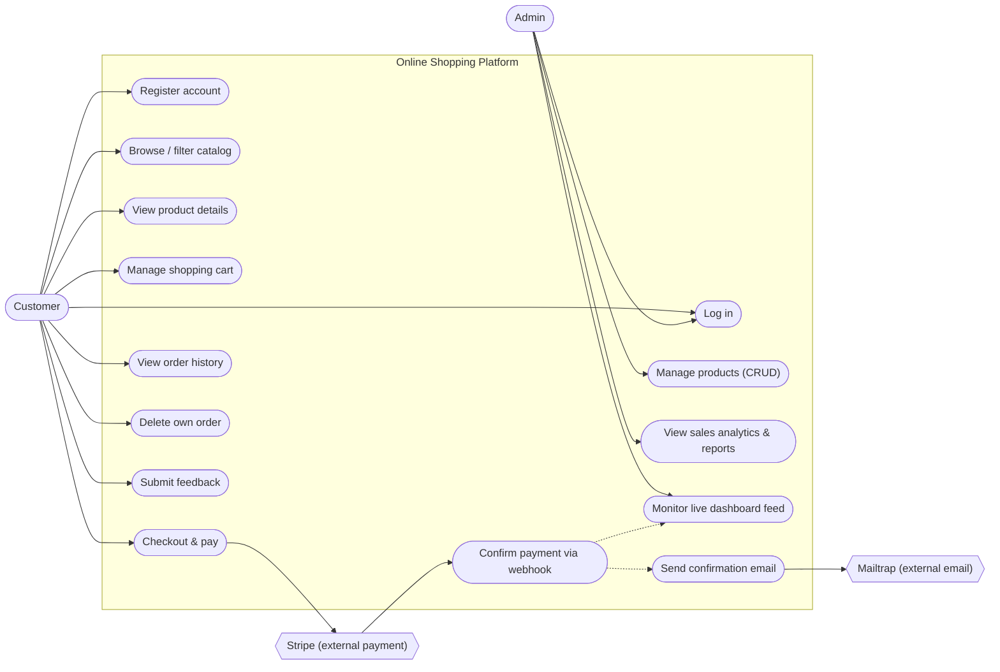

# Software Requirements Specification (SRS)
## Online Shopping Platform

| | |
|---|---|
| **Project** | Online Shopping Platform (e-commerce, Customer + Admin roles) |
| **Document** | Software Requirements Specification |
| **Version** | 1.0 |
| **Date** | 2026-11-03 |
| **Basis** | Derived from the *actual implementation* in the repository (`online-shopping/` backend + `frontend/` React SPA). Requirements not present in code are explicitly marked **[Planned]**. |
| **Team Members** | Himank Sharma (2025SL70020), Saheb Singh (2025SL70010), Karan Naik (2025SL70007) |

---

## 1. Introduction

### 1.1 Purpose
This document specifies the functional and non-functional requirements of the **Online Shopping Platform**, a full-stack e-commerce application. It is a formal reference describing *what the system does*, derived strictly from the implemented source code — not from assumptions about typical e-commerce behaviour. Every requirement maps to code that exists in the repository.

### 1.2 Scope
The system is an online store where **customers** register, browse a product catalog, manage a shopping cart, pay via a hosted payment provider, review their order history, submit feedback, manage a personal wishlist, manage delivery addresses, and edit their profile; and where **administrators** manage the product catalog, view the customer list, and monitor sales, feedback, and live activity. The application consists of:

- A **Spring Boot REST API** backend (`online-shopping/`) with a **MySQL** database.
- A **React single-page application** frontend (`frontend/`).
- Two **external integrations**: **Stripe** (hosted checkout + webhook) and **Mailtrap** (transactional email).

The Stripe payment flow is a deliberate extension beyond the original requirements document (`fsad.md`). Out of scope (not implemented): keyword/full-text product search, discount codes, multi-currency, and user account deletion.

### 1.3 Intended Audience
Developers, testers/QA, project evaluators/academic reviewers, and maintainers. Readers are assumed to understand basic web-application concepts; Spring Boot and React specifics are introduced where needed.

### 1.4 Definitions and Abbreviations

| Term | Meaning |
|---|---|
| **SPA** | Single-Page Application (the React frontend) |
| **REST** | Representational State Transfer; the HTTP/JSON API style used |
| **JWT** | JSON Web Token; signed token proving a user's identity on each request |
| **Bearer token** | A JWT sent in the `Authorization: Bearer <token>` HTTP header |
| **DTO** | Data Transfer Object; the JSON shapes exposed by the API (entities are never returned directly) |
| **ORM** | Object-Relational Mapping (Hibernate/JPA maps Java objects to DB rows) |
| **QOH** | Quantity On Hand — a product's available stock (`qoh`) |
| **STOMP** | Simple Text-Oriented Messaging Protocol; used over WebSocket for the live admin feed |
| **Idempotent** | An operation that produces the same result if applied more than once |
| **Role** | `CUSTOMER` or `ADMIN` — determines authorization |
| **Pending/Paid order** | Order lifecycle states (`PENDING_PAYMENT`, `PAID`, `CANCELLED`) |

---

## 2. Overall Description

### 2.1 Product Perspective
The platform is a **new, self-contained, three-tier web application** (not a module of a larger system). The frontend and backend are independent deployables that communicate only over HTTP — REST/JSON for requests and a single WebSocket channel for the real-time admin feed. The backend owns all business logic, persistence, and the secrets needed to call external services; the browser never contacts Stripe or Mailtrap directly except by being redirected to Stripe's own hosted payment page. (See the separate *High-Level Architecture* and *Database Design* deliverables.)

### 2.2 Product Functionality (summary)
- Account **registration** and **login** with JWT-based authentication.
- **Catalog browsing** (public, no login needed) with category filtering and pagination.
- **Shopping cart** management (add, view, remove; quantities merge).
- **Checkout** with delivery address selection, via Stripe hosted payment, and **order** creation.
- **Order history** viewing (with shipping address snapshot) and deletion of one's own orders.
- **Feedback** submission (rating + message) — both general site feedback and per-product reviews.
- **Wishlist** (favourites): add/remove products from a personal wishlist.
- **Profile management**: edit name and phone; manage multiple delivery addresses.
- **Admin product management** (create/update/delete).
- **Admin customer list**: view all registered customers with KPIs.
- **Admin analytics**: sales by product/category, stock-movement ranking, sales and feedback reports.
- **Real-time admin notifications** (new orders, low stock, new feedback) over WebSocket.
- **Automated order-confirmation email** on successful payment.

### 2.3 User Classes and Characteristics

| User class | Description | Access |
|---|---|---|
| **Customer** (`ROLE_CUSTOMER`) | A registered shopper. All self-registered accounts are customers. | Catalog/product browsing (public), cart, checkout, own orders, feedback, wishlist, profile/addresses. |
| **Administrator** (`ROLE_ADMIN`) | A privileged operator. Created only by the system seeder, never by self-registration. | All `/api/admin/**` functions: product CRUD, reports, customer list, live dashboard. (An admin account can also use customer endpoints.) |
| **Stripe** (external actor) | Payment provider; calls back via a signed webhook. | The public webhook endpoint only. |
| **Mailtrap** (external actor) | Email delivery API; receives order-confirmation emails from the backend. | n/a (outbound only). |
| **Unauthenticated visitor** | A caller with no/invalid token. | Registration, login, the Stripe webhook, API docs, **and product catalog/detail browsing + reading product reviews**. |

### 2.4 Operating Environment
- **Backend:** Java (Spring Boot **4.1.1**), runs on an embedded server (default port **8081**); requires **MySQL 8** (`online_shopping`, auto-created) for production and uses in-memory **H2** for the test profile.
- **Frontend:** React 19 built with Vite 8; dev server on port **5173** which proxies `/api` and `/ws` to the backend. Runs in any modern web browser.
- **External services:** Stripe API and Mailtrap Send API, reachable over HTTPS.

### 2.5 Assumptions and Dependencies
- A reachable MySQL instance and valid environment variables (`DB_*`, `JWT_SECRET`, `STRIPE_*`, `MAILTRAP_*`, `ADMIN_*`, `CORS_ALLOWED_ORIGIN`, `LOW_STOCK_THRESHOLD`) are available at runtime; dev-only fallbacks exist for local use.
- Stripe is configured to send `checkout.session.completed` webhooks to `/api/stripe/webhook`.
- The admin account is bootstrapped at startup from `app.admin.*` (via `AdminSeeder`).
- Correct order fulfilment depends on Stripe actually delivering the webhook — stock is decremented and the order marked paid **only** on webhook receipt, not on redirect return.

---

## 3. Functional Requirements

Each requirement has a unique ID (`FR-<module>-<n>`), the HTTP operation and access role where applicable, and the observable system response. Validation and error responses are produced by Bean Validation + `GlobalExceptionHandler` and are listed per module.

> **Access legend:** Public = no token · Customer = any authenticated user · Admin = `ROLE_ADMIN` only (enforced on `/api/admin/**`).

### 3.1 Module: Authentication & Registration  (`AuthController`, `AuthService`, `JwtService`)

| ID | Requirement | Operation / Access |
|---|---|---|
| **FR-AUTH-1** | The system shall register a new account given a unique email, a password of **≥ 6 characters**, and a non-blank full name. On success it shall create the user, **BCrypt-hash** the password, assign role **CUSTOMER**, and return a JWT with HTTP **201**. | `POST /api/auth/register` · Public |
| **FR-AUTH-2** | The system shall **force role CUSTOMER** on all self-registrations; a client cannot self-assign ADMIN. | (enforced in `AuthService.register`) |
| **FR-AUTH-3** | The system shall reject registration with an already-registered email, returning HTTP **409 Conflict**. | `POST /api/auth/register` · Public |
| **FR-AUTH-4** | The system shall authenticate a login by email + password and, on a match, return a JWT plus the user's role with HTTP **200**. | `POST /api/auth/login` · Public |
| **FR-AUTH-5** | The system shall reject a login with an unknown email or wrong password with HTTP **401 Unauthorized** and a generic message (not revealing which field was wrong). | `POST /api/auth/login` · Public |
| **FR-AUTH-6** | The issued JWT shall encode the user's email (subject) and role, and shall expire after the configured lifetime (default **86 400 000 ms = 24 h**). | (`JwtService`) |
| **FR-AUTH-7** | The system shall create an administrator account on startup from the configured admin email/password if one does not already exist. | `AdminSeeder` (`CommandLineRunner`) |
| **FR-AUTH-8** | On every protected request, the system shall validate the Bearer JWT and set the caller's identity and role; a missing/invalid token shall leave the request unauthenticated (no error thrown by the filter itself). | `JwtAuthFilter` (all requests) |

### 3.2 Module: Product Catalog (Customer-facing)  (`ProductController`, `ProductService`)

| ID | Requirement | Operation / Access |
|---|---|---|
| **FR-PROD-1** | The system shall return a **paginated** list of products (default page size **20**, sorted by `id`). Page/size/sort are client-controllable query parameters. | `GET /api/products` · **Public** |
| **FR-PROD-2** | The system shall optionally filter the product list by **category** when a valid `category` query parameter is supplied (one of: ELECTRONICS, ELECTRICAL, FURNITURE, COSMETICS, TOYS_AND_BOOKS). | `GET /api/products?category=…` · **Public** |
| **FR-PROD-3** | The system shall reject an invalid category value or an invalid sort property with HTTP **400 Bad Request**. | `GET /api/products` · **Public** |
| **FR-PROD-4** | The system shall return a single product's details (id, name, description, price, qoh, category, image_base64) by id, or HTTP **404** if it does not exist. | `GET /api/products/{id}` · **Public** |
| **FR-PROD-5** | Each product response shall expose only DTO fields (no internal JPA entity/version leakage). | (`ProductResponse.from`) |

### 3.3 Module: Admin Product Management  (`AdminProductController`, `ProductService`)

| ID | Requirement | Operation / Access |
|---|---|---|
| **FR-ADMPROD-1** | The system shall let an admin **create** a product with name (non-blank), optional description (≤ 1000 chars), price (**> 0**, ≤ 10 integer + 2 fraction digits), qoh (**≥ 0**), a valid category, and a Base64-encoded product image (`image_base64`, required); returning the created product with HTTP **201**. | `POST /api/admin/products` · Admin |
| **FR-ADMPROD-2** | The system shall let an admin **update** an existing product's fields by id (same validation as create), or return **404** if absent. | `PUT /api/admin/products/{id}` · Admin |
| **FR-ADMPROD-3** | The system shall let an admin **delete** a product by id (HTTP **204**), or return **404** if absent. | `DELETE /api/admin/products/{id}` · Admin |
| **FR-ADMPROD-4** | The system shall reject all product-management calls from non-admin or unauthenticated callers with **403**/**401** respectively. | (SecurityConfig `/api/admin/**`) |

### 3.4 Module: Shopping Cart  (`CartController`, `CartService`)

| ID | Requirement | Operation / Access |
|---|---|---|
| **FR-CART-1** | The system shall return the current user's cart, **creating an empty cart automatically** if none exists (one cart per user). | `GET /api/cart` · Customer |
| **FR-CART-2** | The system shall add a product to the cart with a quantity **≥ 1**. If the product is already in the cart, the system shall **increment the existing line's quantity** rather than add a duplicate line. | `POST /api/cart/items` · Customer |
| **FR-CART-3** | The system shall return **404** when adding a non-existent product to the cart. | `POST /api/cart/items` · Customer |
| **FR-CART-4** | The system shall remove a cart item by its id, but **only if that item belongs to the current user's cart**; otherwise it shall return **403 Forbidden**. Success returns HTTP **204**. | `DELETE /api/cart/items/{itemId}` · Customer |
| **FR-CART-5** | The system shall clear the user's cart automatically after a successful payment (see FR-PAY-5); there is no direct "empty cart" endpoint. | (`CartService.clearCart`) |

### 3.5 Module: Checkout & Payment  (`CheckoutController`, `PaymentService`, `StripeWebhookController`, `OrderService`)

| ID | Requirement | Operation / Access |
|---|---|---|
| **FR-CHK-1** | The system shall reject checkout when the user's cart is **empty**, returning HTTP **400**. | `POST /api/checkout` · Customer |
| **FR-CHK-2** | Before creating any order or payment session, the system shall validate that **every cart line's quantity ≤ the product's current QOH**; if any line exceeds stock it shall return HTTP **409 Conflict** and create nothing. | `POST /api/checkout` · Customer |
| **FR-CHK-3** | The checkout request body must include an `addressId` referencing one of the customer's saved delivery addresses; the system shall **snapshot** the address fields (recipient name, phone, line1, line2, city, state, pincode) onto the order at this moment, so the order record is unaffected by later address changes. | `POST /api/checkout` · Customer |
| **FR-CHK-4** | On a valid cart and address, the system shall create an **Order** in status **PENDING_PAYMENT**, snapshot each line's **price-at-purchase** and quantity into order items, compute the **total amount**, and persist the order. | `POST /api/checkout` · Customer |
| **FR-CHK-5** | The system shall create a **Stripe Checkout Session** for the order's line items, store the returned Stripe session id on the order, and return the order id and the **Stripe redirect URL** to the client. | `POST /api/checkout` · Customer |
| **FR-PAY-1** | The system shall expose a **public** webhook endpoint that accepts Stripe's POST callback with a `Stripe-Signature` header. | `POST /api/stripe/webhook` · Public |
| **FR-PAY-2** | The system shall **verify the webhook signature before any state change**; an invalid signature shall return HTTP **400** and change nothing. | `StripeGateway.completedSessionId` |
| **FR-PAY-3** | On a verified webhook, the system shall look up the order by Stripe session id. If the session is **unknown**, it shall log and **ignore** it (no error). | `OrderService.markOrderPaid` |
| **FR-PAY-4** | The mark-as-paid operation shall be **idempotent**: if the order is already **PAID**, it shall return early and make no further changes (safe for Stripe's retried webhooks). | `OrderService.markOrderPaid` |
| **FR-PAY-5** | In a single transaction, a successful payment shall: (a) **decrement each product's QOH** by the ordered quantity, **clamped at 0** (never negative); (b) set the order status to **PAID**; (c) **clear the user's cart**; (d) **send an order-confirmation email**; (e) **push a new-order notification** and any **low-stock notifications** to admins. | `OrderService.markOrderPaid` |

### 3.6 Module: Order Management  (`OrderController`, `OrderService`)

| ID | Requirement | Operation / Access |
|---|---|---|
| **FR-ORD-1** | The system shall return the authenticated user's own orders, **most recent first**, each including its line items, totals, and the **shipping address snapshot** (may be null for orders placed before the address feature was introduced). | `GET /api/orders` · Customer |
| **FR-ORD-2** | The system shall delete an order by id **only if it belongs to the current user**; otherwise **403**. A missing order returns **404**; success returns **204**. | `DELETE /api/orders/{id}` · Customer |
| **FR-ORD-3** | A user shall never see or act on another user's orders (ownership is enforced server-side, not by the client). | (`OrderService`) |

### 3.7 Module: Feedback  (`FeedbackController`, `FeedbackService`)

| ID | Requirement | Operation / Access |
|---|---|---|
| **FR-FB-1** | The system shall let an authenticated user submit **general site feedback** consisting of a **non-blank message (≤ 2000 chars)** and an integer **rating between 1 and 5**, returning the stored feedback with HTTP **201**. | `POST /api/feedback` · Customer |
| **FR-FB-2** | The system shall reject feedback with a blank/oversized message or a rating outside 1–5 with HTTP **400**. | `POST /api/feedback` · Customer |
| **FR-FB-3** | On successful submission, the system shall **push a feedback notification** to the admin live feed. | (`NotificationService`) |
| **FR-FB-4** | Feedback is associated with the submitting user and a server-set timestamp. | (`Feedback` entity) |

### 3.8 Module: Admin Sales Analytics  (`SalesController`, `SalesAnalysisService`)

| ID | Requirement | Operation / Access |
|---|---|---|
| **FR-SALES-1** | The system shall return aggregated sales lines over a **reporting period** (`WEEK`, `MONTH` [default], `QUARTER`, `YEAR`), grouped either by **PRODUCT** (default) or by **CATEGORY**. | `GET /api/admin/sales?period=…&groupBy=…` · Admin |
| **FR-SALES-2** | The reporting period shall be computed relative to the current UTC time (e.g. MONTH = last 1 month). | (`SalesPeriod.since`) |
| **FR-SALES-3** | The system shall return a **stock-movement ranking** of products over the chosen period. | `GET /api/admin/sales/movement?period=…` · Admin |
| **FR-SALES-4** | Analytics shall be derived from **PAID** order data (sales aggregates query order/order-item/product data). | (`OrderRepository` projections) |

### 3.9 Module: Admin Reports  (`ReportController`, `ReportService`)

| ID | Requirement | Operation / Access |
|---|---|---|
| **FR-RPT-1** | The system shall return a **sales report** summarising sales over a given period (default MONTH). | `GET /api/admin/reports/sales?period=…` · Admin |
| **FR-RPT-2** | The system shall return a **feedback report** aggregating submitted feedback. | `GET /api/admin/reports/feedback` · Admin |

### 3.10 Module: Real-Time Admin Dashboard  (`WebSocketConfig`, `StompAuthChannelInterceptor`, `NotificationService`)

| ID | Requirement | Operation / Access |
|---|---|---|
| **FR-RT-1** | The system shall expose a WebSocket/STOMP endpoint at **`/ws`** and authenticate the **STOMP CONNECT** frame using the JWT in its `Authorization` header. | `/ws` · token required |
| **FR-RT-2** | The system shall allow **only `ROLE_ADMIN`** clients to **SUBSCRIBE** to `/topic/admin/**`, and shall **forbid any client from SENDing** to `/topic/**`. | `StompAuthChannelInterceptor` |
| **FR-RT-3** | The system shall publish a message to **`/topic/admin/orders`** when an order becomes PAID. | (`NotificationService.notifyNewOrder`) |
| **FR-RT-4** | The system shall publish to **`/topic/admin/low-stock`** only when a paid decrement causes a product's QOH to **cross from above the threshold to at/below** the configured `app.low-stock-threshold` (default **5**). | (`notifyLowStockIfCrossed`) |
| **FR-RT-5** | The system shall publish to **`/topic/admin/feedback`** when new feedback is submitted. | (`NotificationService`) |
| **FR-RT-6** | All notification sends shall be wrapped so that a push failure **never breaks** the triggering transaction (e.g. a paid order still completes if the push fails). | (try/catch in `NotificationService`) |

### 3.11 Module: Email Notifications  (`EmailService`, `MailtrapApiEmailTransport`)

| ID | Requirement | Operation / Access |
|---|---|---|
| **FR-EMAIL-1** | The system shall send an **order-confirmation email** to the customer upon successful payment, via the Mailtrap HTTPS Send API. | (triggered by FR-PAY-5) |
| **FR-EMAIL-2** | Email sending shall use HTTPS (port 443), and its failure shall not break order completion. | (`MailtrapApiEmailTransport`) |

### 3.12 Module: Security & Access Control (cross-cutting)  (`SecurityConfig`, `JwtAuthFilter`)

| ID | Requirement | Operation / Access |
|---|---|---|
| **FR-SEC-1** | The system shall treat as **public** (no token required): `/api/auth/**`, `/api/stripe/webhook`, `/api/products` (GET), `/api/products/{id}` (GET), `/api/products/{id}/feedback` (GET), `/ws/**`, and the Swagger/OpenAPI paths; all other endpoints require authentication. | (SecurityConfig) |
| **FR-SEC-2** | The system shall restrict every `/api/admin/**` endpoint to `ROLE_ADMIN`. | (SecurityConfig) |
| **FR-SEC-3** | The system shall return **401** for unauthenticated access to a protected resource and **403** for an authenticated user lacking the required role. | (custom entry point) |
| **FR-SEC-4** | The system shall operate **statelessly** (no server session) and with **CSRF disabled** (bearer-token model), accepting cross-origin requests only from the configured allowed origin. | (SecurityConfig, CorsConfig) |
| **FR-SEC-5** | The system shall provide interactive **API documentation** via Swagger UI. | `GET /swagger-ui.html` · Public |

### 3.13 Frontend Behaviour (React SPA)
These describe the implemented client, which consumes the API above.

| ID | Requirement |
|---|---|
| **FR-UI-1** | The SPA shall store the JWT in browser `localStorage` and attach it to every API call via the shared `fetch` wrapper. |
| **FR-UI-2** | The SPA shall guard routes with `ProtectedRoute`: unauthenticated users are redirected to login; non-admins are blocked from `/admin`. The catalog (`/`) and product detail (`/products/:id`) routes are **public** — no `ProtectedRoute` wrapper. |
| **FR-UI-3** | The SPA shall provide pages for: catalog (category filter chips + paging), product detail (with per-product reviews section), cart (with delivery address selector), orders (with shipping address), feedback, wishlist, profile (account details + address management), login/register, checkout success/cancel, and an admin dashboard. |
| **FR-UI-4** | The admin dashboard shall open one STOMP WebSocket and render live order, low-stock, and feedback events as they arrive. |
| **FR-UI-5** | The SPA shall surface backend `ApiError` messages to the user and distinguish 401 (log in) from other errors. |

### 3.14 Module: Per-Product Reviews  (`ProductFeedbackController`, `FeedbackService`)

| ID | Requirement | Operation / Access |
|---|---|---|
| **FR-PRODREV-1** | The system shall return all reviews for a product, including reviewer name, rating, message, and timestamp, keyed by product id. | `GET /api/products/{productId}/feedback` · **Public** |
| **FR-PRODREV-2** | An authenticated user shall be able to submit a review for a specific product (rating 1–5, message ≤ 2000 chars), returning the stored review with HTTP **201**. The same validation rules as general feedback apply. | `POST /api/products/{productId}/feedback` · Customer |
| **FR-PRODREV-3** | The system shall return **404** when attempting to submit a review for a non-existent product. | `POST /api/products/{productId}/feedback` · Customer |
| **FR-PRODREV-4** | Product reviews reuse the `Feedback` entity; a review row has a non-null `product_id` FK (general feedback has `product_id = null`). | (`Feedback` entity) |

### 3.15 Module: Wishlist / Favourites  (`FavouriteController`, `FavouriteService`)

| ID | Requirement | Operation / Access |
|---|---|---|
| **FR-FAV-1** | The system shall return the authenticated customer's current wishlist (list of favourited products). | `GET /api/favourites` · Customer |
| **FR-FAV-2** | The system shall add a product to the customer's wishlist; adding a product that is already wishlisted shall be **idempotent** (enforced by a unique constraint on `(user_id, product_id)`). | `POST /api/favourites/{productId}` · Customer |
| **FR-FAV-3** | The system shall remove a product from the customer's wishlist (HTTP **204**); removing a product that is not wishlisted shall be a no-op. | `DELETE /api/favourites/{productId}` · Customer |
| **FR-FAV-4** | The system shall return **404** if the referenced product does not exist. | (`FavouriteService`) |

### 3.16 Module: Profile Management  (`ProfileController`, `UserRepository`)

| ID | Requirement | Operation / Access |
|---|---|---|
| **FR-PROFILE-1** | The system shall return the authenticated user's profile: email (read-only), full name, phone, and their saved delivery addresses. | `GET /api/profile` · Customer |
| **FR-PROFILE-2** | The system shall allow the authenticated user to update their **full name** (non-blank) and **phone** (10-digit number), returning the updated profile. | `PUT /api/profile` · Customer |
| **FR-PROFILE-3** | The system shall reject updates with a blank name or a phone that is not exactly 10 digits with HTTP **400**. | `PUT /api/profile` · Customer |

### 3.17 Module: Delivery Address Management  (`AddressController`, `AddressService`)

| ID | Requirement | Operation / Access |
|---|---|---|
| **FR-ADDR-1** | The system shall return the authenticated customer's saved delivery addresses. | `GET /api/addresses` · Customer |
| **FR-ADDR-2** | The system shall create a new delivery address for the customer given label (non-blank), recipient name, phone, line1, city, state, pincode (all non-blank), and an optional line2. | `POST /api/addresses` · Customer |
| **FR-ADDR-3** | The system shall update an existing address by id, applying the same validation as create. It shall return **404** if the address does not exist and **403** if it belongs to a different user. | `PUT /api/addresses/{id}` · Customer |
| **FR-ADDR-4** | The system shall set a specified address as the customer's **default** address, unsetting the previous default. | `PUT /api/addresses/{id}/default` · Customer |
| **FR-ADDR-5** | The system shall delete an address by id (HTTP **204**), enforcing ownership; returns **404** / **403** as above. | `DELETE /api/addresses/{id}` · Customer |

### 3.18 Module: Admin Customer Management  (`AdminCustomerController`, `AdminCustomerService`)

| ID | Requirement | Operation / Access |
|---|---|---|
| **FR-ADMCUST-1** | The system shall return a list of all registered customers including: full name, email, phone, address count, order count, lifetime spend, join date, and status (ACTIVE/INACTIVE). | `GET /api/admin/customers` · Admin |
| **FR-ADMCUST-2** | The customer status enum (`UserStatus`) supports a **soft-delete model**: an INACTIVE customer's history (orders, feedback) remains in the database; only the status flag changes. | (`UserStatus`, `AdminCustomerService`) |

---

## 4. Non-Functional Requirements (concise)

| ID | Category | Requirement (as supported by the implementation) |
|---|---|---|
| **NFR-PERF-1** | Performance | Product listing is **paginated** (default 20/page) to bound payload and query size. |
| **NFR-SEC-1** | Security | Stateless **JWT** auth, **BCrypt** password hashing, role-based authorization, CORS restricted to a configured origin, Stripe webhook signature verification, secrets read from environment variables. |
| **NFR-REL-1** | Reliability | Payment settlement is **transactional and idempotent**; notification/email failures are isolated (swallowed) so they cannot corrupt order state. |
| **NFR-USE-1** | Usability | SPA distinguishes 401 vs 403 for clear messaging; validation errors return specific field messages. |
| **NFR-SCALE-1** | Scalability | Stateless backend (no server session) permits horizontal scaling; **limitation:** the WebSocket broker is Spring's **in-memory simple broker**, which does not share state across instances. |
| **NFR-MAINT-1** | Maintainability | Strict layered architecture, constructor injection, DTO boundary, `StripeGateway`/`EmailTransport` interfaces for test stubbing; tests run on H2 with no external services. |
| **NFR-COMPAT-1** | Compatibility | Backend on Java/Spring Boot 3 + MySQL 8 (H2 for tests); frontend runs in modern browsers; all integration over standard HTTP(S)/WebSocket. |

---

## 5. External Interface Requirements

### 5.1 User Interface
- Web-based React SPA served by Vite; pages listed in FR-UI-3. Communicates with the backend exclusively via the REST API and the `/ws` WebSocket. No native/mobile client exists.

### 5.2 Software Interfaces
- **Stripe API** (via `stripe-java` SDK): creates Checkout Sessions and verifies webhook signatures. The `StripeGateway` interface abstracts the SDK (stubbed in tests).
- **Mailtrap Send API** (HTTPS JSON): sends order-confirmation emails (`MailtrapApiEmailTransport` implementing `EmailTransport`).
- **Database driver:** MySQL Connector/J (prod), H2 (test), accessed through Hibernate/JPA.

### 5.3 API Interfaces (REST — full implemented surface)

| Method & Path | Access | Purpose | Ref |
|---|---|---|---|
| `POST /api/auth/register` | Public | Register customer | FR-AUTH-1 |
| `POST /api/auth/login` | Public | Log in, get JWT | FR-AUTH-4 |
| `GET /api/products` | **Public** | List/filter/paginate products | FR-PROD-1/2 |
| `GET /api/products/{id}` | **Public** | Product detail | FR-PROD-4 |
| `GET /api/products/{id}/feedback` | **Public** | List product reviews | FR-PRODREV-1 |
| `POST /api/products/{id}/feedback` | Customer | Submit product review | FR-PRODREV-2 |
| `POST /api/admin/products` | Admin | Create product | FR-ADMPROD-1 |
| `PUT /api/admin/products/{id}` | Admin | Update product | FR-ADMPROD-2 |
| `DELETE /api/admin/products/{id}` | Admin | Delete product | FR-ADMPROD-3 |
| `GET /api/cart` | Customer | View/auto-create cart | FR-CART-1 |
| `POST /api/cart/items` | Customer | Add/increment cart item | FR-CART-2 |
| `DELETE /api/cart/items/{itemId}` | Customer | Remove cart item | FR-CART-4 |
| `POST /api/checkout` | Customer | Create order + Stripe session (with addressId) | FR-CHK-1..5 |
| `POST /api/stripe/webhook` | Public | Stripe payment callback | FR-PAY-1..5 |
| `GET /api/orders` | Customer | List own orders (with shipping address) | FR-ORD-1 |
| `DELETE /api/orders/{id}` | Customer | Delete own order | FR-ORD-2 |
| `POST /api/feedback` | Customer | Submit general site feedback | FR-FB-1 |
| `GET /api/favourites` | Customer | List wishlist | FR-FAV-1 |
| `POST /api/favourites/{productId}` | Customer | Add to wishlist | FR-FAV-2 |
| `DELETE /api/favourites/{productId}` | Customer | Remove from wishlist | FR-FAV-3 |
| `GET /api/profile` | Customer | Get own profile + addresses | FR-PROFILE-1 |
| `PUT /api/profile` | Customer | Update name + phone | FR-PROFILE-2 |
| `GET /api/addresses` | Customer | List own addresses | FR-ADDR-1 |
| `POST /api/addresses` | Customer | Create address | FR-ADDR-2 |
| `PUT /api/addresses/{id}` | Customer | Update address | FR-ADDR-3 |
| `PUT /api/addresses/{id}/default` | Customer | Set default address | FR-ADDR-4 |
| `DELETE /api/addresses/{id}` | Customer | Delete address | FR-ADDR-5 |
| `GET /api/admin/customers` | Admin | List all customers | FR-ADMCUST-1 |
| `GET /api/admin/sales` | Admin | Sales by product/category | FR-SALES-1 |
| `GET /api/admin/sales/movement` | Admin | Stock-movement ranking | FR-SALES-3 |
| `GET /api/admin/reports/sales` | Admin | Sales report | FR-RPT-1 |
| `GET /api/admin/reports/feedback` | Admin | Feedback report | FR-RPT-2 |
| `/ws` (WebSocket/STOMP) | Admin (subscribe) | Live dashboard feed | FR-RT-1..5 |

Request/response bodies are JSON DTOs; errors use a consistent `ApiError` shape (`{ status, message, ... }`).

### 5.4 Database Interface
- Relational schema (**9 tables**: `users`, `products`, `carts`, `cart_items`, `orders`, `order_items`, `feedback`, `addresses`, `favourites`), generated by Hibernate (`ddl-auto=update`). Full detail is in the *Database Design* deliverable. Access is via Spring Data JPA repositories only; no raw JDBC in business code.

---

## 6. System Constraints and Dependencies

- **CON-1:** Orders are settled **only on Stripe webhook receipt** — if the webhook is never delivered, stock is not decremented and the order stays `PENDING_PAYMENT`. The redirect back to the SPA does not itself finalize the order.
- **CON-2:** Stock is enforced **at checkout time** (FR-CHK-2) and clamped at 0 on decrement; it is not reserved while in the cart, so concurrent checkouts can oversell within a race window (mitigated by product `@Version` optimistic locking on updates).
- **CON-3:** The live admin feed uses an **in-memory broker** — notifications are not persisted or replayed; a disconnected admin misses events emitted while offline.
- **CON-4:** All administrator accounts are provisioned by the **seeder**; there is no UI/endpoint to promote a customer to admin.
- **CON-5:** Secrets and endpoints must be supplied via **environment variables**; dev fallbacks are for local use only and are not production-safe.
- **CON-6:** The system is **single-currency** and prices are stored as `DECIMAL(12,2)`; no currency field or tax/shipping calculation exists.

---

## 7. Use Cases

### UC-1 — Register Account
- **Actor:** Customer (unauthenticated). **Ref:** FR-AUTH-1/2/3.
- **Preconditions:** None.
- **Main flow:** 1) User submits email, password (≥6), full name. 2) System checks email is unused. 3) System hashes password, creates a CUSTOMER user. 4) System returns a JWT (201).
- **Alternative flows:** (2a) Email already exists → **409**. (1a) Invalid field → **400** with messages.
- **Postcondition:** A new customer account exists; the client holds a valid JWT.

### UC-2 — Log In
- **Actor:** Customer or Admin. **Ref:** FR-AUTH-4/5.
- **Preconditions:** Account exists.
- **Main flow:** 1) User submits email + password. 2) System verifies the BCrypt hash. 3) System returns JWT + role (200).
- **Alternative flow:** (2a) Unknown email or wrong password → **401** (generic message).
- **Postcondition:** Client holds a JWT carrying the user's role.

### UC-3 — Browse and Filter Catalog
- **Actor:** Customer or unauthenticated visitor. **Ref:** FR-PROD-1/2/4, FR-PRODREV-1.
- **Preconditions:** None (public access).
- **Main flow:** 1) User opens catalog. 2) System returns page 1 (20 items, sorted by id). 3) User selects a category / changes page. 4) System returns the filtered/paged results. 5) User opens a product to see details and per-product reviews.
- **Alternative flows:** (3a) Invalid category/sort → **400**. (5a) Unknown product id → **404**.
- **Postcondition:** Requested products and reviews are displayed (no login required).

### UC-4 — Manage Shopping Cart
- **Actor:** Customer. **Ref:** FR-CART-1..4.
- **Preconditions:** Authenticated.
- **Main flow:** 1) User views cart (auto-created if none). 2) User adds a product with quantity ≥ 1. 3) If already present, system increments that line; else adds a new line. 4) User removes an item they own. 5) System returns the updated cart.
- **Alternative flows:** (2a) Product not found → **404**. (2b) Quantity < 1 → **400**. (4a) Item not owned by user → **403**.
- **Postcondition:** Cart contents reflect the user's actions.

### UC-5 — Checkout and Pay (primary business transaction)
- **Actor:** Customer, with Stripe as a participating system. **Ref:** FR-CHK-1..5, FR-PAY-1..5, FR-EMAIL-1, FR-RT-3/4.
- **Preconditions:** Authenticated; cart is non-empty; customer has at least one saved delivery address.
- **Main flow:** 1) User selects a delivery address and initiates checkout. 2) System validates every line against current stock. 3) System snapshots the chosen address onto the order, creates a PENDING_PAYMENT order with price snapshots and total. 4) System creates a Stripe Checkout Session and returns its URL. 5) User is redirected to Stripe and pays. 6) Stripe sends a signed webhook. 7) System verifies the signature, then (idempotently, in one transaction) decrements stock (clamped ≥0), marks the order PAID, clears the cart, emails confirmation, and notifies admins.
- **Alternative flows:** (1a) No address selected → blocked in UI. (1b) Empty cart → **400**, nothing created. (2a) Insufficient stock → **409**, nothing created. (6a) Invalid signature → **400**, no state change. (6b) Unknown session → ignored. (6c) Duplicate/replayed webhook for an already-PAID order → no-op. (7a) Email/notification failure → logged and swallowed; the order still completes.
- **Postcondition:** On success, order is PAID with shipping address snapshot, stock reduced, cart empty, confirmation sent, admins notified.

### UC-6 — View / Delete Own Orders
- **Actor:** Customer. **Ref:** FR-ORD-1/2.
- **Preconditions:** Authenticated.
- **Main flow:** 1) User requests order history. 2) System returns the user's orders, newest first. 3) User deletes one of their orders. 4) System returns 204.
- **Alternative flows:** (3a) Order not found → **404**. (3b) Order belongs to another user → **403**.
- **Postcondition:** The selected order is removed; others are unaffected.

### UC-7 — Submit Feedback
- **Actor:** Customer. **Ref:** FR-FB-1/2/3.
- **Preconditions:** Authenticated.
- **Main flow:** 1) User submits a message (≤2000) and rating (1–5). 2) System stores it against the user with a timestamp (201). 3) System pushes a feedback event to admins.
- **Alternative flow:** (1a) Invalid message/rating → **400**.
- **Postcondition:** Feedback is persisted and surfaced on the admin feed.

### UC-8 — Admin Manage Products
- **Actor:** Admin. **Ref:** FR-ADMPROD-1..4.
- **Preconditions:** Authenticated as ADMIN.
- **Main flow:** 1) Admin creates/updates/deletes a product with valid fields. 2) System persists and returns the result (201/200/204).
- **Alternative flows:** (1a) Validation failure → **400**. (1b) Unknown id on update/delete → **404**. (0a) Non-admin caller → **403**.
- **Postcondition:** Catalog reflects the change.

### UC-9 — Admin View Analytics & Monitor Live Feed
- **Actor:** Admin. **Ref:** FR-SALES-1..4, FR-RPT-1/2, FR-RT-1..6, FR-ADMCUST-1.
- **Preconditions:** Authenticated as ADMIN.
- **Main flow:** 1) Admin requests sales (by product/category), movement ranking, or reports for a period. 2) System returns the aggregates. 3) Admin views the Customers tab — system returns all registered customers with KPIs. 4) Admin's dashboard connects to `/ws` and subscribes to admin topics. 5) System pushes order/low-stock/feedback events in real time.
- **Alternative flows:** (4a) Non-admin SUBSCRIBE attempt → rejected. (5a) Push failure → silently dropped, no impact on source transactions.
- **Postcondition:** Admin sees current analytics, customer list, and live activity.

### UC-10 — Manage Wishlist
- **Actor:** Customer. **Ref:** FR-FAV-1..4.
- **Preconditions:** Authenticated.
- **Main flow:** 1) Customer clicks the heart on a product card or detail page → system adds it to the wishlist (idempotent). 2) Customer navigates to `/wishlist` → system returns the list of favourited products. 3) Customer removes a product by clicking the heart again → system deletes the row (no-op if not present).
- **Alternative flows:** (1a) Product not found → **404**.
- **Postcondition:** Wishlist reflects the customer's actions.

### UC-11 — Manage Profile and Addresses
- **Actor:** Customer. **Ref:** FR-PROFILE-1..3, FR-ADDR-1..5.
- **Preconditions:** Authenticated.
- **Main flow:** 1) Customer visits Profile page → system returns profile + addresses. 2) Customer edits name/phone and saves → system validates and persists (200). 3) Customer adds an address → system validates and creates it. 4) Customer sets an address as default → system updates the flag. 5) Customer edits or deletes an address.
- **Alternative flows:** (2a) Blank name or non-10-digit phone → **400**. (3a) Invalid/missing required fields → **400**. (5a) Address not found or not owned → **404/403**.
- **Postcondition:** Profile and address list reflect the customer's changes; the default address is pre-selected on the next checkout.

