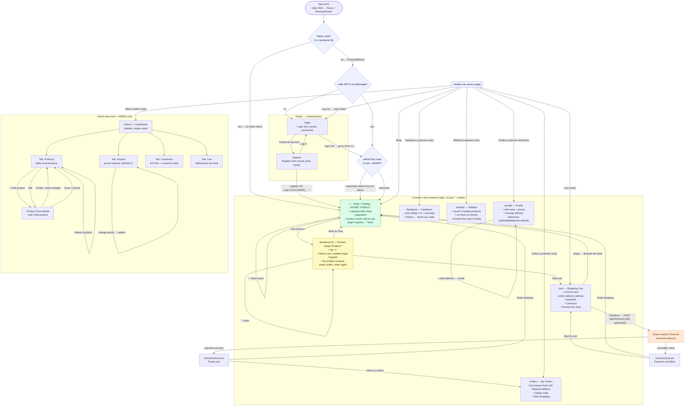

# UI Design — User Interface Flow Diagram
## Online Shopping Platform ("everystore")

## 1. Overview

The frontend is a **React 19 single-page application** (SPA) using `react-router-dom` for client-side routing. One persistent **Header** sits above every page; the body swaps between page components as the URL changes. Two React Contexts hold shared state: **AuthContext** (JWT, role, email — persisted in `localStorage`) and **CartContext** (cart item count). Access is gated client-side by a **`ProtectedRoute`** wrapper, and mirrored server-side by the JWT requirement on the API.

There are **two user roles** — **Customer** and **Admin** — and the navigation visibly differs between them (see §4).

---

## 2. Screen Inventory (all implemented)

| Route | Screen | Access | Purpose |
|---|---|---|---|
| `/login` | **Login** | Public | Email + password sign-in; link to Register. |
| `/register` | **Register** | Public | Create a customer account (email, password, full name); link to Login. |
| `/` | **Shop / Catalog** *(home)* | **Public** | Landing page visible to anyone (no login needed); product grid with category-filter chips and pagination; each card has *Add to cart* (redirects guests to login) and a heart button for wishlisting. |
| `/products/:id` | **Product Detail** | **Public** | Single product; quantity stepper, *Add to cart*, *View cart*, *Back to shop*; includes per-product reviews section at the bottom. Guests can read reviews; login required to submit one or add to cart. |
| `/cart` | **Shopping Cart** | Customer | Line items with *remove*; delivery address selector (required before checkout); *Checkout* (hands off to Stripe); *Browse the shop* when empty. |
| `/checkout/success` | **Checkout Success** | Customer | Stripe return on payment; *View my orders* / *Keep shopping*. |
| `/checkout/cancel` | **Checkout Cancel** | Customer | Stripe return on cancel; *Back to cart* / *Keep shopping*. |
| `/orders` | **My Orders** | Customer | Order history (newest first); each order shows shipping address snapshot; *delete* an order; *Start shopping* when empty. |
| `/feedback` | **Feedback** | Customer | Star rating (1–5) + message (general site feedback); submit → thank-you state. |
| `/wishlist` | **Wishlist** | Customer | Products the customer has hearted; remove by clicking the heart again; *Browse the shop* when empty. |
| `/profile` | **Profile** | Customer | Edit full name and phone; manage saved delivery addresses (add / edit / set default / delete). |
| `/admin` | **Admin Dashboard** | **Admin only** | Single route with four tabs: **Products**, **Reports**, **Customers**, **Live**. |
| `*` (fallback) | → renders **Catalog** | — | Any unknown path renders the Catalog component. |

**Admin Dashboard sub-screens (tabs within `/admin`, not separate routes):**

| Tab / element | Purpose |
|---|---|
| **Products** tab (`ProductManager`) | Table of all products with *+ Add product*, *Edit*, *Delete* (with confirm). |
| **Product Form Modal** (`ProductFormModal`) | Overlay for Add/Edit — same form, create vs. update decided by context. |
| **Reports** tab (`ReportsPanel`) | Period selector (Week/Month/Quarter/Year); revenue by category, top sellers, stock movement, recent feedback. |
| **Customers** tab (`CustomersPanel`) | KPI tiles (total / active / inactive customers, lifetime revenue); table of all registered customers with name, email, phone, address count, order count, lifetime spend, join date, and status badge (ACTIVE/INACTIVE). |
| **Live** tab (`LiveFeed`) | Real-time WebSocket feed of new orders, low-stock alerts, and feedback. |

---

## 3. Entry Point & Conditional Navigation

- **Entry point:** the browser loads `index.html`, which mounts React inside `<BrowserRouter>` (`main.jsx`). The first meaningful screen depends on auth state.
- **Public browsing:** the Catalog (`/`) and Product Detail (`/products/:id`) are accessible without a token — guests can browse and read reviews. When an unauthenticated visitor tries to add to cart, wishlist, or submit a review, they are redirected to `/login` with the original path remembered.
- **Auth gate (`ProtectedRoute`):** every non-public route is wrapped. If there is **no token**, the user is redirected to `/login`, and the originally requested path is remembered (`state.from`) so login can return there. After a successful login the app navigates to that `from` path (or `/`).
- **Role gate:** `/admin` is wrapped with `adminOnly`. An authenticated **non-admin** who reaches it is bounced back to `/` (the Catalog). The **Admin** nav link is only rendered for admins, so the redirect is a safety net rather than the usual path.
- **Registration** always creates a **CUSTOMER** and navigates to `/` on success.

---

## 4. Role-Based Navigation (Header)

The header renders different controls by auth/role (`Header.jsx`):

| Nav element | Shown when |
|---|---|
| **Shop** (`/`) | Always |
| **Orders**, **Wishlist**, **Feedback** | Authenticated customer (`role !== ADMIN`) |
| **Admin** (`/admin`) | `role === ADMIN` only |
| **Cart** (with live item count), **Log out** | Authenticated |
| **User email** (links to `/profile`) | Authenticated customer only |
| **User email** (plain text, no link) | Authenticated admin |
| **Log in**, **Sign up** | Not authenticated |

So a **Customer** sees Shop / Orders / Wishlist / Feedback / Cart / Profile-link / Log out; an **Admin** sees Shop / Admin / Cart / email (no profile link) / Log out. Unauthenticated visitors see Shop plus Log in / Sign up.

---

## 5. UI Flow Diagram

---

## 6. Major User Journeys

**J1 — First-time customer (register → buy).**
Entry → auth gate sends an unauthenticated visitor to **Login** → *Create an account* → **Register** → on success lands on **Catalog**. Browse/filter → open **Product Detail** → *Add to cart* → **Cart** (select delivery address) → *Checkout* → redirected to **Stripe** → pay → **Checkout Success** → *View my orders* shows the new (paid) order with the shipping address.

**J2 — Returning customer (shop & manage orders).**
Login → **Catalog** (home). Add items from cards or the product page → **Cart** (address auto-selected to default) → checkout. Later, **Orders** to review history or delete an order; **Feedback** to leave a site rating.

**J3 — Public browse (no login).**
Unauthenticated visitor opens the app → lands on **Catalog** directly (no login required). Browses products, opens **Product Detail**, reads per-product reviews — all without an account. Clicking *Add to cart* or the heart redirects to **Login**; they can register and return to the product they were viewing.

**J4 — Abandoned payment.**
From **Cart** → *Checkout* → **Stripe** → back out → **Checkout Cancel** (nothing charged) → *Back to cart* or *Keep shopping*. The pending order remains unpaid server-side.

**J5 — Admin operations.**
Login as admin → **Admin** link appears → **Dashboard**. *Products* tab: add/edit/delete catalog items via the modal. *Reports* tab: pick a period and read revenue/top-sellers/movement/feedback. *Customers* tab: view KPI tiles and browse the customer table. *Live* tab: watch orders, low-stock, and feedback stream in over WebSocket. An admin can still use all customer screens.

**J6 — Wishlist.**
Authenticated customer → clicks the heart (♡) on any product card or on the Product Detail page → product added to wishlist. Navigates to **Wishlist** via nav → sees all hearted products as cards → clicks the heart again (♥ → ♡) to remove.

**J7 — Manage profile and addresses.**
Customer clicks their email in the header → **Profile** page. Edits name or phone and saves. Clicks *+ Add address* → **AddressFormModal** overlay → fills in label, recipient, phone, address lines → saves. Address appears in the list; can be edited, deleted, or set as default. The default address is auto-selected on the **Cart** page when checking out.

**J8 — Blocked/again-login.**
A non-admin visiting `/admin` is redirected to the Catalog. Any deep link to a protected page while logged out redirects to **Login** and returns there after signing in. **Log out** clears the session and returns to **Login**.

---

## 7. How Frontend Modules Connect

- **`main.jsx`** mounts `BrowserRouter` → `AuthProvider` → `CartProvider` → `FavouritesProvider` → `App`, so every page can read auth, cart, and wishlist state.
- **`App.jsx`** declares all routes and renders the persistent **Header**; `ProtectedRoute` enforces auth/role on protected routes. Catalog and Product Detail are *not* wrapped — they are public.
- **Pages** call the backend through the shared **`api/client.js`** wrapper (attaches the Bearer JWT). The admin **Live** tab additionally uses **`useAdminSocket.js`** (STOMP WebSocket).
- **Contexts** are the connective tissue: `AuthContext` drives what the Header shows and what `ProtectedRoute` allows; `CartContext` keeps the header cart count in sync with cart actions; `FavouritesContext` keeps the heart button state in sync across cards and the Product Detail page.
- **Admin page** composes four child components (`ProductManager`, `ReportsPanel`, `CustomersPanel`, `LiveFeed`); `ProductManager` opens `ProductFormModal` for create/update.
- **Profile page** composes the address list inline and opens `AddressFormModal` for create/edit.

